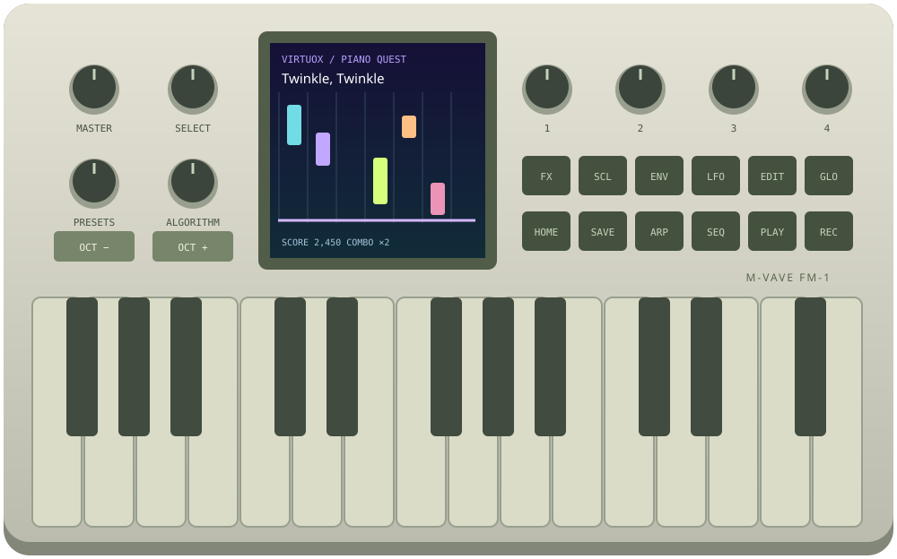

# VirtuoX — The Interactive Piano Engine

**Piano learning and DX7-compatible FM synthesis for the M-VAVE FM-1.**

[Project website](https://telespial.github.io/virtuox-mvave-fm1/) · [Play the browser demo](https://telespial.github.io/virtuox-mvave-fm1/play/) · [Full manual](https://telespial.github.io/virtuox-mvave-fm1/manual.html) · [Firmware & recovery center](https://telespial.github.io/virtuox-mvave-fm1/install.html)



VirtuoX is an independent, open-source music-learning instrument by Richard Haberkern / **telespial**. It combines an M-VAVE FM-1 control-panel layout with a playable browser piano coach and a regular DX7-compatible synthesizer.

**Current release: browser prototype. Native FM-1 teaching firmware is in development; no flashable VirtuoX `.fwsc` is released.** The firmware center links to official recovery tools and checks local file hashes; it does not flash hardware.

## What you can use today

- **Piano Coach:** 100 supplied studies plus 10 licensed MIDI editions, colorful falling notes or grand staff, child/adult profiles, six difficulty levels, adjustable timing, hand selection, loops, demonstrations and automatic course continuation.
- **Core Matrix:** combine songs, basic music theory, scales, chords, rhythm and technique in GLO → Learning. Concept cards explain the musical task before playing.
- **Pulse:** optional accuracy-based tempo adjustment between exercises or repeated loops. It does not continuously alter tempo during a phrase.
- **DX7-Compatible Player:** free play without lessons or scores; six-operator FM synthesis with 32 algorithms, sound macros, six operator-edit pages, envelopes and LFO.
- **Factory sounds:** 128 M-VAVE FM-1 V15 factory voices, in four banks of 32, with documented browser compatibility adjustments. Import your own single-voice or 32-voice DX7 `.syx` files locally.
- **Analog-inspired sounds:** six subtractive presets with oscillator, filter, resonance, envelope, sub oscillator, drive and modulation controls. Not exact Moog models and not DX7-exportable voices.
- **Effects:** chorus, delay, reverb, filter and drive through Web Audio.
- **Sequencer:** visible editable 16/32/64-step grid, chord entry, example groove, Run/Stop, looping, gate, swing and velocity. Player mode also includes a held-note arpeggiator.
- **MIDI input:** USB/OS MIDI ports through Web MIDI; channel filtering, velocity, sustain and modulation wheel. Direct BLE MIDI pairing is not implemented. Actual latency depends on the connected system.
- **Make your own exercises:** MIDI format 0/1 and lesson-JSON import; sequence/recording-to-lesson tools; song and progress export.

## Try it

Open the [HTTPS demo](https://telespial.github.io/virtuox-mvave-fm1/play/), click **Switch on**, and play. Desktop Chrome or Edge is recommended for Web MIDI. No FM-1 is needed for the browser app; a real MIDI keyboard is useful for wider and two-hand studies.

For an immediate sequencer test: **Compose → Load example groove → Run sequence**. Click a numbered step and play notes to edit it. Empty steps are rests. Stop cancels scheduled events and releases sequence notes.

## Scoring is based on complete musical events

A chord earns points only when every required tone is physically held together. Single-key taps cannot accumulate a chord. Timed mode checks every onset and a chord-spread limit; feedback uses the worst onset error. Missing notes affect timing percentages. Wait mode explicitly leaves onset timing ungraded. Scores, combos and musical assessment percentages are separate measures.

## Public factory sounds and personal DX7 banks

The public build uses the M-VAVE V15 factory bank identified in the official `m-vave/fm1_open` repository. It does **not** bundle the private Yamaha ROM/Dexed archive.

- Original source: `third-party/m-vave/fm_factory.inc` at upstream commit `4c7496daac04a95ff10d1afdcc8f9ead2dbabc41`.
- Original decoded VMEM SHA-256: `ecad0b8620f9d784d46c8da1e3c5de02c40214649ed8dec218026431046aad25`.
- Original VMEM is retained unchanged. The browser synth requires stricter ranges: 12 parameters are adjusted, listed in `third-party/m-vave/compatibility-adjustments.json`. The browser `.syx` downloads contain the adapted voices.
- Factory data retains its Apache-2.0 attribution. See [THIRD_PARTY.md](THIRD_PARTY.md).
- Personal banks can be imported locally. Keep files with unconfirmed redistribution terms out of public commits, source archives and release assets. `.gitignore` does not remove files already committed.

## Local development and tests

No framework build or package installation is required. JavaScript modules and the WASM synth are served statically.

```bash
# From the repository root, use Node.js 22+ for tests and asset generation:
node scripts/build-factory-banks.mjs
node --test tests/*.test.mjs

# Serve docs/ with a static HTTP server for UI development.
# HTTPS or a secure localhost context is required for AudioWorklet/Web MIDI.
# Do not open play/index.html as a file:// URL.
```

GitHub Pages serves `main` → `/docs`. `.nojekyll` keeps the buildless layout intact. CI runs the tests and checks public content. Source files are published alongside the demo; no backend receives practice data or imported patches.

## Repository layout

| Path | Purpose |
|---|---|
| `docs/` | Project site, manual, firmware center, search metadata |
| `docs/play/` | Working browser instrument and lesson/synthesis logic |
| `docs/play/step-sequencer.js` | DOM-independent timed playback scheduler |
| `docs/play/engine/` | Apache-2.0 MSFA DX7 WASM engine and JS interface |
| `third-party/m-vave/` | Factory-bank provenance, original bytes, notices and adjustment log |
| `scripts/` | Reproducible factory-bank generation and public-content checks |
| `tests/` | Lessons, chord scoring, menus, banks, MIDI protocol and sequence scheduling |
| `.github/` | CI and issue templates |

## Firmware roadmap and hardware limits

The browser application is not a native FM-1 binary and is not the complete JIANT firmware. A native port needs C integration, physical LCD/input/LED behavior, device persistence, CPU/memory/audio measurements, update/recovery testing and matching source/build instructions. Those are development tasks, not completed features.

The browser has stock-V16 and JIANT/Felucca patch-transfer protocol paths. These are for **DX7 voice parameters**, not for installing VirtuoX. Physical device validation is outstanding. Browser effects and analog sounds are not transferred as DX7 patches.

## Search and discovery

This project concerns **M-VAVE FM-1 / MVAVE FM1 / M VAVE FM-1**, **DX7-compatible FM synthesis**, **MIDI piano learning**, music theory, scales, chord voicings, real-time note feedback, SysEx sound banks and open-source synthesizer firmware development. The site includes descriptive titles, canonical URLs, Open Graph metadata, structured source-code data, a sitemap and robots policy. Search engines control whether and when pages are indexed; no ranking is guaranteed.

## Contributing

Read [CONTRIBUTING.md](CONTRIBUTING.md). Reproducible bug reports are especially useful: include browser/OS, MIDI device, mode, bank/slot, lesson or sequence, BPM, swing/gate and the exact steps. Do not attach private patch banks without permission.

## Credits and licenses

Coach/UI adaptations are GPL-3.0-only. Panel code is adapted from JIANT by Juan Ignacio Antonucci, based on Felucca by Leo Kuroshita / Hügelton Instruments and the X0X browser emulator by charlesvestal. Source basis: JIANT commit `cfff2d40de49cd0d6d8cd30aa60393c225a9c303`.

Synthesis: `tetorica-msfa-dx7-wasm` 0.3.1, derived from Google MSFA and the Dexed lineage, Apache-2.0. DotGothic16: SIL OFL 1.1. M-VAVE factory data: separate Apache-2.0 attribution. See [LICENSE](LICENSE), [THIRD_PARTY.md](THIRD_PARTY.md) and component notices.

M-VAVE, FM-1, Yamaha, DX7 and Moog are trademarks of their respective owners. VirtuoX is independent and is not affiliated with or endorsed by those companies or JIANT. The VirtuoX name is a project label, not a claim of exclusive trademark rights; similarly named products exist outside this project.

## Expressive synth studies and firmware research

Player has synth-only global pages, mono/analog legato and glide, analog pitch bend, modulation and eight project slots with JSON backups. Piano Coach includes 28 original artist-inspired studies and ten attributed Mutopia MIDI editions. Musical licenses are documented separately in THIRD_PARTY.md. Full native FM-1 parity is unfinished: the browser currently has one sequence track, no stock sampler and no external MIDI-clock engine. See [firmware research and feature comparison](https://telespial.github.io/virtuox-mvave-fm1/firmware-research.html) for official FM1 Open, JIANT, SLOOP and Felucca.

Yamaha and DX7 are trademarks of Yamaha Corporation. VirtuoX is an independent project and is not affiliated with or endorsed by Yamaha.

## Player display and editing

The Player LCD uses measured output audio for its scope, actual held-note/velocity feedback, per-page ENV/LFO/FX diagrams and a sequencer piano roll. ENV adds independent operator and pitch R1–R4/L1–L4 editing; LFO adds amplitude depth, delay, operator amplitude sensitivity and sync controls. These diagrams distinguish measured audio from schematic parameter views. PLAY runs the existing sequence from sound pages; SAVE/PLAY store and recall the selected project from the Projects page.

## LCD learning styles and style demos

In Piano Coach, press GLO and turn SELECT to page 8, Learning style. The four knobs select style, lesson, difficulty and tempo. PLAY starts the selected lesson with its matching sound; REC previews a curated, ungraded two-pass phrase for that style, and REC again stops it. The browser also has Demo selected style buttons in the library and on this page. Mozart/Bach editions load directly from local MIDI assets with loading/error feedback on the LCD. The selected lesson remains selected while a demo plays. These controls run in the browser panel; native VirtuoX firmware remains unfinished.
